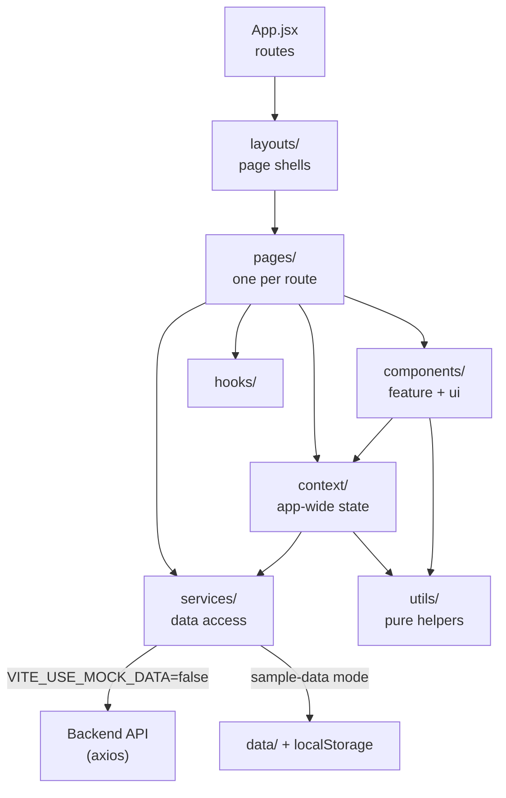

# Architecture

This document describes how the NOVA storefront is put together: how a request moves from a page to the data and back, where state lives, and what has to change when the real backend comes online. For setup instructions, see [README.md](README.md).

## Overview

NOVA is a client-only React single-page app built with Vite. Code is split into layers, and each layer depends only on the layers below it:



Components never call axios directly. Every network call goes through a service module, so the switch from sample data to the real API happens in one place.

## Routing

All routes are defined in [src/App.jsx](src/App.jsx). Three layouts wrap them:

| Layout | Routes | What it provides |
|---|---|---|
| `MainLayout` | `/`, `/shop`, `/product/:slug`, `/cart`, `/wishlist`, `/collections/*`, `/about`, `/help`, `/legal/:doc`, `/account/*`, 404 | Announcement bar, navbar, footer, cart drawer, search panel, mobile menu. Resets scroll and closes overlays on navigation. |
| `AuthLayout` | `/login`, `/register`, `/forgot-password`, `/reset-password?token=…` | A split-screen sign-in shell. Redirects visitors who are already signed in. |
| `CheckoutLayout` | `/checkout`, `/checkout/confirmation/:orderId` | A distraction-free shell with no navigation, search or cart drawer. |

**Code splitting.** `HomePage` is bundled with the main app so the first page loads quickly. Every other page is loaded with `React.lazy`, and a single `<Suspense>` boundary shows a blank placeholder while a page loads.

**Protected routes.** `/account/*` is wrapped in [`RequireAuth`](src/components/account/RequireAuth.jsx). It sends signed-out visitors to `/login?redirect=<path>`, and they come back to that page after signing in. `useRedirectTarget` in `AuthLayout` only accepts same-origin paths (starting with `/` but not `//`), which prevents open redirects. If a user signs out on purpose, they're sent to `exitTo` instead of the sign-in page.

**Expired sessions.** When the API answers 401 to a request that carried a token, the session has expired or been revoked. `api.js` fires a `nova:session-expired` event on `window`. `AuthProvider` listens for it, clears the stored session and shows "Your session has ended". `RequireAuth` then sends the user to sign in and back to the page they were on. A 401 on a request *without* a token, such as a wrong password at sign-in, doesn't fire the event.

**Deep links in production.** Routing happens in the browser, so the host must answer every path with `index.html`. On Vercel, [vercel.json](vercel.json) does this with a rewrite. Vercel serves real files (`/assets/*`, `/favicon.svg`) before applying rewrites, so those are unaffected.

**URL as state.** Shop filters (search, category, price, rating, stock, sale, sort) are stored in the query string by [`useShopFilters`](src/hooks/useShopFilters.js). This makes filtered views shareable, bookmarkable and friendly to the back button.

## State management

There's no state library. App-wide state lives in five React contexts, composed in [src/context/AppProviders.jsx](src/context/AppProviders.jsx):

```
ToastProvider → AuthProvider → UIProvider → WishlistProvider → CartProvider
```

The order matters: a provider can use the contexts above it, but not the ones below it.

| Context | Holds | Persisted to |
|---|---|---|
| `ToastContext` | Notification queue (at most 3 at once, auto-dismissed, optional action such as "Undo") | — |
| `AuthContext` | Signed-in user; `signIn`, `register`, `signOut`, `updateProfile`, `requestPasswordReset`, `resetPassword`. Ends the session when the API reports it expired. | `localStorage` if "remember me" is on, otherwise `sessionStorage` |
| `UIContext` | Which overlay is open: `cart`, `search`, `menu` or none. Only one can be open at a time. | — |
| `WishlistContext` | Product IDs, with `toggle` / `remove` / `restore` (undo puts an item back in its original position) | `localStorage` |
| `CartContext` | Cart lines, promo code, computed totals, and `loading` while product details are fetched | `localStorage` |

Each context exposes a `useX()` hook that throws if it's used outside its provider.

**The cart stores IDs, not products.** Each cart line saves only `{ key, productId, quantity, color, size }`. Product details and prices are looked up through the [product cache](#the-product-cache) when the cart is read, so carts left in browsers always show current prices instead of stale ones. While those details load (API mode only), `loading` is `true`, and the cart page, cart drawer and checkout show a blank placeholder rather than "Your bag is empty". The wishlist works the same way. A line's `key` is `productId|color|size`, so the same product in a different variant becomes a separate line. Quantities are capped at the stock count, and at 10 per line.

**Local state** is managed by small hooks in [src/hooks/](src/hooks/):

- `useAsync(loader, deps)` tracks `{ data, loading, error, retry }` and ignores responses that arrive after the component has unmounted. Pages use it for every data load, and `retry` powers the error states.
- `useForm(initial, validate)` handles form values and validation. An error appears once the user leaves a field, or for every field after the first submit attempt. `field(name)` returns props you can spread onto an input.
- `useLocalStorage(key, initial)` is `useState` with JSON persistence. If storage is unavailable (private mode, full quota), it keeps the state in memory instead.
- `useProducts(ids)` turns a list of product IDs (cart lines, wishlist) into products, in the same order, and reports `loading` until they're all fetched. See [the product cache](#the-product-cache).

## Data layer

### Services

The modules in [src/services/](src/services/) are the only code that talks to a backend:

| Service | Responsibility |
|---|---|
| `api.js` | Shared axios instance, the `USE_MOCK_DATA` flag and `mockDelay` |
| `productService` | Product lists, the shop catalogue query with facet counts, product details, reviews, related products, categories, collections, testimonials |
| `authService` | Sign in, register, sign out, password reset, profile, password change, account deletion |
| `cartService` | Promo code validation |
| `orderService` | Placing orders, order lookup, order history, cancellation |
| `addressService` | Address book: list, save, remove, set default |
| `newsletterService`, `supportService` | Newsletter sign-up, contact form |

Every service method follows the same pattern:

```js
async getThing(id) {
  if (!USE_MOCK_DATA) {
    const { data } = await api.get(`/things/${id}`);
    return data;
  }
  return mockDelay(/* sample result */);
}
```

`mockDelay` adds a short artificial delay (about 300–1600 ms) and returns a deep copy of the data. The delay means loading states actually appear during development, and the copy stops components from accidentally changing the sample data.

### Product queries: one contract for `GET /products`

Every product list in the app comes from `GET /products`: homepage rails, the shop page, cart and wishlist suggestions, the search panel, and lookups by ID. All of them go through one helper, `fetchProducts` in [productService.js](src/services/productService.js), so the backend sees one set of parameter names and always returns the same shape:

| Parameter | Meaning |
|---|---|
| `q` | Search text |
| `categories` | Comma-separated category slugs |
| `ids` | Comma-separated product IDs |
| `featured`, `bestSeller`, `inStock`, `onSale` | `true` when the filter is on; left out otherwise |
| `minPrice`, `maxPrice`, `minRating` | Numeric filters |
| `sort` | One of `SORT_OPTIONS` in [useShopFilters.js](src/hooks/useShopFilters.js): `featured`, `popular`, `newest`, `price-asc`, `price-desc`, `rating`, `discount` |
| `limit` | Maximum number of items |

The response is always `{ items, total, facets }`. `total` is the number of matches before `limit`. `facets.categories` maps each category slug to a count that ignores the category filter itself, so each option shows how many results selecting it would give. `productService.list()` returns just `items`, for callers that only need an array.

### The product cache

Some screens hold product IDs, not products: the cart, the wishlist and "Buy again". They need product details without waiting for a page-level request. `productService` keeps a cache for them:

- **Sample-data mode:** the cache starts with the whole catalogue, so lookups are instant.
- **API mode:** every product the API returns is added to the cache, and newer responses overwrite older entries, so prices and stock stay current. `loadByIds(ids)` fetches anything missing in one request (`GET /products?ids=a,b,c`). IDs the API doesn't return are marked unavailable, and lists drop them instead of loading forever.
- `findById(id)` reads the cache synchronously. `useProducts(ids)` re-renders when the cache changes.

The search panel calls `productService.search(term, 5)`, which is `GET /products?q=…&limit=5`. It waits for a 200 ms pause in typing, so each keystroke isn't a request.

### The axios client

[src/services/api.js](src/services/api.js) configures the client:

- `baseURL` comes from `VITE_API_URL` (default `/api`). Requests time out after 15 seconds.
- **A request interceptor** adds `Authorization: Bearer <token>` using `nova:token` from local or session storage.
- **A response interceptor** attaches `error.userMessage` and `error.code` from the server's response (see below). If the server didn't send a message, it uses one for timeouts, otherwise a generic one. On a 401 for a request that carried a token, it also fires `nova:session-expired` (see [Expired sessions](#routing)).

### Errors

API error responses are JSON shaped `{ message, code }`:

- `message` is text that's safe to show the user. It becomes `error.userMessage`.
- `code` is a stable identifier the UI can branch on. It becomes `error.code`.

The UI checks these codes today: `email_taken` on register and in settings, and `invalid_token` on the reset-password page. Sample-data services reject with errors of exactly the same shape, for example `invalid_credentials`, `card_declined` and `not_cancellable`. So UI code handles both modes the same way.

### Sample-data mode

When `VITE_USE_MOCK_DATA` isn't `false`:

- **Catalogue**: products, categories, collections, reviews and testimonials come from [src/data/](src/data/). Filtering, sorting and facet counts are done in `productService`. The results match the expected `GET /products` response shape, `{ items, total, facets }`.
- **Accounts**: stored in `nova:users`, with passwords hashed using SHA-256. A demo account is created automatically. Tokens are random `mock.<uuid>` strings. Saved addresses are stored per user in `nova:addresses:<userId>`.
- **Password reset**: no email is sent. `requestPasswordReset` stores a token in `nova:password-resets` and returns `devResetPath`, which the forgot-password page shows as a link. Like a real link, it expires after 1 hour and works once.
- **Orders**: stored in `nova:orders` (the 50 most recent). A card ending in `0002` is declined, so you can test the error state.

This mode is for development only. Hashing passwords in the browser and storing them in `localStorage` isn't secure. All authentication has to move to the backend before launch.

## Browser storage keys

| Key | Storage | Contents |
|---|---|---|
| `nova:session`, `nova:token` | local or session | Signed-in user and bearer token |
| `nova:cart`, `nova:promo` | local | Cart lines and the applied promo code |
| `nova:wishlist` | local | Wishlist product IDs |
| `nova:checkout-draft` | session | Checkout form progress, kept across page reloads |
| `nova:checkout-id` | session | `{ id, cart }`: the `checkoutId` for the current cart, so a repeated "Place order" is recognised (see below) |
| `nova:announcement-dismissed` | local | ID of the dismissed announcement banner |
| `nova:users`, `nova:orders` | local | Sample-data mode only: fake accounts and orders |
| `nova:addresses:<userId>` | local | Sample-data mode only: each user's saved addresses |
| `nova:password-resets` | local | Sample-data mode only: password reset tokens and their expiry times |

## Checkout and pricing

- [`computeTotals`](src/utils/pricing.js) is the single function that calculates order totals. The cart drawer, cart page and checkout all use it. Prices include tax. Free-shipping thresholds are checked against the subtotal **before** discounts. A promo with a minimum spend is kept but marked inactive (`promoShortfall`) until the subtotal reaches the minimum.
- Checkout validation rules live in [checkoutSchema.js](src/components/checkout/checkoutSchema.js). They're built from helpers in [src/utils/validation.js](src/utils/validation.js): email, phone, postal code by country, card number (Luhn check), expiry and CVC.
- **One order per "Place order".** A ref blocks a second submit while one is in flight, so a double click can't send two. Each order also carries a `checkoutId`, one per cart, and the server returns the existing order for a repeated id. The id is kept when the outcome is unknown (timeout, network error, 5xx), and replaced after a definite answer, a success or a cart change. The full rules are under `POST /orders` in [docs/API.md](docs/API.md).
- The full card number never leaves the checkout form. The order sends `payment: { method, brand, last4 }`, and the checkout draft saved in `sessionStorage` leaves out all card fields. With the real backend, the card fields should be replaced by a payment provider's hosted fields, and the payment token they return sent instead.
- The order sends item prices and totals worked out in the browser. The backend must **not** trust them: it should recalculate everything from product IDs, quantities, the promo code and the shipping method.

## Styling

- Tailwind CSS 4 is loaded through `@tailwindcss/vite`, so there's no `tailwind.config.js`. Design tokens (colours, fonts) are defined in an `@theme` block in [src/index.css](src/index.css) and become utility classes such as `text-ink` and `bg-surface`.
- The custom variant `can-hover:` applies hover styles only on devices with a precise pointer, so they don't stick on touch screens.
- `cn()` in [src/utils/cn.js](src/utils/cn.js) joins conditional class names.
- The fonts are Inter and Manrope, loaded from Google Fonts in `index.html`.
- Reusable building blocks (Button, Field, Sheet, Accordion, Toaster…) live in [src/components/ui/](src/components/ui/).

## Accessibility

- Every layout has a "Skip to content" link that targets `#main`.
- Colour tokens meet WCAG AA contrast (see the note on `--color-muted` in `index.css`).
- Overlays close on Escape (`useEscapeKey`) and lock page scrolling while open (`useLockBodyScroll`).

## Connecting the real backend

The full request and response bodies for every endpoint are in [docs/API.md](docs/API.md), and the database design is in [docs/DATA_MODEL.md](docs/DATA_MODEL.md). This section is the short version.

1. Set `VITE_USE_MOCK_DATA=false` and point `VITE_API_URL` at the API.
2. Make the API implement the endpoints the services already call:

   | Area | Endpoints |
   |---|---|
   | Auth | `POST /auth/login`, `/auth/register`, `/auth/logout`, `/auth/forgot-password`, `/auth/reset-password` (`{ token, password }`). Login and register return `{ user, token }`. The reset email links to `/reset-password?token=…`. |
   | Profile | `PATCH /me`, `DELETE /me`, `POST /me/password` |
   | Addresses | `GET /me/addresses`, `POST /me/addresses`, `PUT /me/addresses/:id`, `DELETE /me/addresses/:id`, `POST /me/addresses/:id/default` |
   | Catalogue | `GET /products` (see [the contract](#product-queries-one-contract-for-get-products)), `GET /products/:slug` (with `?include=details` for the product page), `/products/:id/reviews`, `/products/:id/related`, `GET /categories`, `GET /collections/:slug`, `GET /reviews/featured` |
   | Orders | `POST /orders`, `GET /orders/:id`, `GET /me/orders`, `POST /orders/:id/cancel` |
   | Other | `POST /cart/promo`, `POST /newsletter`, `POST /support/messages` |

3. Return errors as `{ message, code }` (see [Errors](#errors)), using the codes the UI already checks. Return 401 only when a session is missing, expired or revoked, because the app signs the user out when it gets one.
4. Follow these response shapes the UI relies on:
   - The address calls that change something (save, remove, set default) return the **whole updated address list**.
   - `GET /orders/:id` is used by the order confirmation page, including for guest orders. Protect it, for example with a secret token returned with the order, because orders contain names and addresses.
5. Remove the sample-data branches from the services, and stop using the sample-only storage keys (`nova:users`, `nova:orders`, `nova:addresses:<userId>`, `nova:password-resets`).
