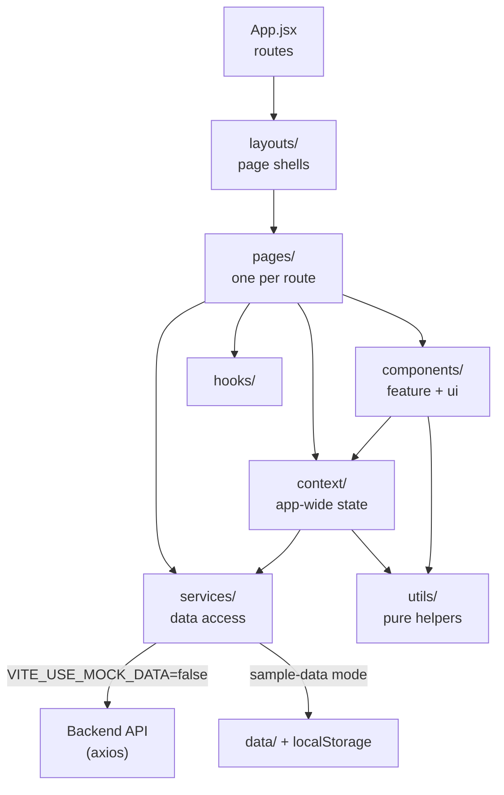

# Architecture

This document describes how the NOVA storefront is put together: how a request moves from a page to the data and back, where state lives, and what has to change when the real backend comes online. For setup instructions, see [README.md](README.md).

## Overview

NOVA is a client-only React single-page app built with Vite. Code is split into layers, and each layer depends only on the layers below it:



Components never call axios directly. Every network call goes through a service module, so the switch from sample data to the real API happens in one place.

## Routing

All routes are defined in [src/App.jsx](src/App.jsx). Three layouts wrap them:

| Layout | Routes | What it provides |
|---|---|---|
| `MainLayout` | `/`, `/shop`, `/product/:slug`, `/cart`, `/wishlist`, `/collections/*`, `/about`, `/help`, `/legal/:doc`, `/account/*`, 404 | Announcement bar, navbar, footer, cart drawer, search panel, mobile menu. Resets scroll and closes overlays on navigation. |
| `AuthLayout` | `/login`, `/register`, `/forgot-password` | A split-screen sign-in shell. Redirects visitors who are already signed in. |
| `CheckoutLayout` | `/checkout`, `/checkout/confirmation/:orderId` | A distraction-free shell with no navigation, search or cart drawer. |

**Code splitting.** `HomePage` is bundled with the main app so the first page loads quickly. Every other page is loaded with `React.lazy`, and a single `<Suspense>` boundary shows a blank placeholder while a page loads.

**Protected routes.** `/account/*` is wrapped in [`RequireAuth`](src/components/account/RequireAuth.jsx). It sends signed-out visitors to `/login?redirect=<path>`, and they come back to that page after signing in. `useRedirectTarget` in `AuthLayout` only accepts same-origin paths (starting with `/` but not `//`), which prevents open redirects. If a user signs out on purpose, they're sent to `exitTo` instead of the sign-in page.

**URL as state.** Shop filters (search, category, price, rating, stock, sale, sort) are stored in the query string by [`useShopFilters`](src/hooks/useShopFilters.js). This makes filtered views shareable, bookmarkable and friendly to the back button.

## State management

There's no state library. App-wide state lives in five React contexts, composed in [src/context/AppProviders.jsx](src/context/AppProviders.jsx):

```
ToastProvider → AuthProvider → UIProvider → WishlistProvider → CartProvider
```

The order matters: a provider can use the contexts above it, but not the ones below it.

| Context | Holds | Persisted to |
|---|---|---|
| `ToastContext` | Notification queue (at most 3 at once, auto-dismissed, optional action such as "Undo") | — |
| `AuthContext` | Signed-in user; `signIn`, `register`, `signOut`, `updateProfile` | `localStorage` if "remember me" is on, otherwise `sessionStorage` |
| `UIContext` | Which overlay is open: `cart`, `search`, `menu` or none. Only one can be open at a time. | — |
| `WishlistContext` | Product IDs, with `toggle` / `remove` / `restore` (undo puts an item back in its original position) | `localStorage` |
| `CartContext` | Cart lines, promo code, computed totals | `localStorage` |

Each context exposes a `useX()` hook that throws if it's used outside its provider.

**The cart stores IDs, not products.** Each cart line saves only `{ key, productId, quantity, color, size }`. Product details and prices are looked up when the cart is read. Once prices come from the API, carts left in browsers therefore always show current prices instead of stale ones. A line's `key` is `productId|color|size`, so the same product in a different variant becomes a separate line. Quantities are capped at the stock count, and at 10 per line.

**Local state** is managed by small hooks in [src/hooks/](src/hooks/):

- `useAsync(loader, deps)` tracks `{ data, loading, error, retry }` and ignores responses that arrive after the component has unmounted. Pages use it for every data load, and `retry` powers the error states.
- `useForm(initial, validate)` handles form values and validation. An error appears once the user leaves a field, or for every field after the first submit attempt. `field(name)` returns props you can spread onto an input.
- `useLocalStorage(key, initial)` is `useState` with JSON persistence. If storage is unavailable (private mode, full quota), it keeps the state in memory instead.

## Data layer

### Services

The modules in [src/services/](src/services/) are the only code that talks to a backend:

| Service | Responsibility |
|---|---|
| `api.js` | Shared axios instance, the `USE_MOCK_DATA` flag and `mockDelay` |
| `productService` | Product lists, the shop catalogue query with facet counts, product details, reviews, related products, categories, collections, testimonials |
| `authService` | Sign in, register, sign out, password reset, profile, password change, account deletion |
| `cartService` | Promo code validation |
| `orderService` | Placing orders, order lookup, order history, cancellation |
| `addressService` | Address book: list, save, remove, set default |
| `newsletterService`, `supportService` | Newsletter sign-up, contact form |

Every service method follows the same pattern:

```js
async getThing(id) {
  if (!USE_MOCK_DATA) {
    const { data } = await api.get(`/things/${id}`);
    return data;
  }
  return mockDelay(/* sample result */);
}
```

`mockDelay` adds a short artificial delay (about 300–1600 ms) and returns a deep copy of the data. The delay means loading states actually appear during development, and the copy stops components from accidentally changing the sample data.

### The axios client

[src/services/api.js](src/services/api.js) configures the client:

- `baseURL` comes from `VITE_API_URL` (default `/api`). Requests time out after 15 seconds.
- **A request interceptor** adds `Authorization: Bearer <token>` using `nova:token` from local or session storage.
- **A response interceptor** attaches a readable `error.userMessage`. It uses the server's `message` if there is one, otherwise a message for timeouts, otherwise a generic one.

### Errors

Services reject with an `Error` that carries `userMessage` (text that's safe to show to the user) and, when relevant, a `code` such as `invalid_credentials` or `card_declined`. Errors from sample data and from the API look the same, so UI code handles both with `error.userMessage`.

### Sample-data mode

When `VITE_USE_MOCK_DATA` isn't `false`:

- **Catalogue**: products, categories, collections, reviews and testimonials come from [src/data/](src/data/). Filtering, sorting and facet counts are done in `productService`. The results match the expected `GET /products` response shape, `{ items, total, facets }`.
- **Accounts**: stored in `nova:users`, with passwords hashed using SHA-256. A demo account is created automatically. Tokens are random `mock.<uuid>` strings.
- **Orders**: stored in `nova:orders` (the 50 most recent). Only the card brand and last four digits are kept. A card number ending in `0002` is declined, so you can test the error state.

This mode is for development only. Hashing passwords in the browser and storing them in `localStorage` isn't secure. All authentication has to move to the backend before launch.

## Browser storage keys

| Key | Storage | Contents |
|---|---|---|
| `nova:session`, `nova:token` | local or session | Signed-in user and bearer token |
| `nova:cart`, `nova:promo` | local | Cart lines and the applied promo code |
| `nova:wishlist` | local | Wishlist product IDs |
| `nova:checkout-draft` | session | Checkout form progress, kept across page reloads |
| `nova:announcement-dismissed` | local | ID of the dismissed announcement banner |
| `nova:users`, `nova:orders` | local | Sample-data mode only: fake accounts and orders |

## Checkout and pricing

- [`computeTotals`](src/utils/pricing.js) is the single function that calculates order totals. The cart drawer, cart page and checkout all use it. Prices include tax. Free-shipping thresholds are checked against the subtotal **before** discounts. A promo with a minimum spend is kept but marked inactive (`promoShortfall`) until the subtotal reaches the minimum.
- Checkout validation rules live in [checkoutSchema.js](src/components/checkout/checkoutSchema.js). They're built from helpers in [src/utils/validation.js](src/utils/validation.js): email, phone, postal code by country, card number (Luhn check), expiry and CVC.
- The full card number is only kept until `placeOrder` sends it. The stored order keeps only `last4`. With the real backend, card data should go to a payment provider's hosted fields instead of through this app.

## Styling

- Tailwind CSS 4 is loaded through `@tailwindcss/vite`, so there's no `tailwind.config.js`. Design tokens (colours, fonts) are defined in an `@theme` block in [src/index.css](src/index.css) and become utility classes such as `text-ink` and `bg-surface`.
- The custom variant `can-hover:` applies hover styles only on devices with a precise pointer, so they don't stick on touch screens.
- `cn()` in [src/utils/cn.js](src/utils/cn.js) joins conditional class names.
- The fonts are Inter and Manrope, loaded from Google Fonts in `index.html`.
- Reusable building blocks (Button, Field, Sheet, Accordion, Toaster…) live in [src/components/ui/](src/components/ui/).

## Accessibility

- Every layout has a "Skip to content" link that targets `#main`.
- Colour tokens meet WCAG AA contrast (see the note on `--color-muted` in `index.css`).
- Overlays close on Escape (`useEscapeKey`) and lock page scrolling while open (`useLockBodyScroll`).

## Connecting the real backend

1. Set `VITE_USE_MOCK_DATA=false` and point `VITE_API_URL` at the API.
2. Make the API implement the endpoints the services already call:

   | Area | Endpoints |
   |---|---|
   | Auth | `POST /auth/login`, `/auth/register`, `/auth/logout`, `/auth/forgot-password` — login and register return `{ user, token }` |
   | Profile | `PATCH /me`, `DELETE /me`, `POST /me/password` |
   | Addresses | `GET /me/addresses`, `POST /me/addresses`, `PUT /me/addresses/:id`, `DELETE /me/addresses/:id`, `POST /me/addresses/:id/default` |
   | Catalogue | `GET /products` (returns `{ items, total, facets }`), `GET /products/:slug`, `/products/:id/reviews`, `/products/:id/related`, `GET /categories`, `GET /collections/:slug`, `GET /reviews/featured` |
   | Orders | `POST /orders`, `GET /orders/:id`, `GET /me/orders`, `POST /orders/:id/cancel` |
   | Other | `POST /cart/promo`, `POST /newsletter`, `POST /support/messages` |

3. Make error responses include a `message` field, so the response interceptor can show it to users.
4. Remove the sample-data branches from the services, and stop using the `nova:users` and `nova:orders` keys.
5. Check the methods that look products up synchronously from the local catalogue (`productService.findById` and `searchLocal`). They're used by the cart, the search panel, the wishlist grid, the account overview and "Buy again", so they need an API-backed replacement or a cache.
