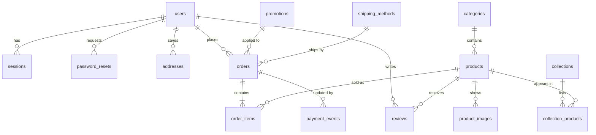

# NOVA data model

**Status:** v1, for PostgreSQL. **Implemented** in [server/src/db/schema.ts](../server/src/db/schema.ts); this document and that file must agree. It covers everything [API.md](API.md) needs and nothing more. Each section ends with what was deliberately left out, so it's clear what to add later and why it isn't needed yet.

**Contents**
1. [Overview](#1-overview)
2. [Conventions](#2-conventions)
3. [Accounts](#3-accounts)
4. [Catalogue](#4-catalogue)
5. [Promotions and shipping](#5-promotions-and-shipping)
6. [Orders and payments](#6-orders-and-payments)
7. [Engagement](#7-engagement)
8. [Rules that span tables](#8-rules-that-span-tables)
9. [Seeding from the sample data](#9-seeding-from-the-sample-data)
10. [Open decisions](#10-open-decisions)

## 1. Overview

Seventeen tables in five groups: accounts, catalogue, promotions and shipping, orders and payments, and engagement. Orders **copy** what they need at purchase time (item names, prices, addresses, promo, shipping label). Editing a product, an address or a promo later never changes a past order.

## 2. Conventions

| Topic | Rule |
|---|---|
| Primary keys | `text`, using the prefixes the frontend already shows: `u-`, `p-`, `addr-`, `NV-`. Generate them from random bytes, not sequences, so they can't be guessed. |
| Money | `integer` **cents**, in columns named `*_cents`. The API converts to major units at the edge. One `currency` column per order, so a currency change later doesn't rewrite history. |
| Time | `timestamptz`, stored in UTC. Every table has `created_at default now()`. Mutable tables also have `updated_at`. |
| Email | `text`, lowercased and trimmed before saving. A CHECK (`email = lower(btrim(email))`, on `users`, `orders` and `newsletter_subscribers`) guarantees it, so a plain unique index is case-insensitive and every stored account can sign in. No `citext` extension is needed. |
| Secrets | Tokens (sessions, password resets, guest order access) are stored **only as SHA-256 hashes**. Passwords use scrypt from Node's standard library (memory-hard, OWASP-recommended alongside argon2id and bcrypt), never plain SHA-256. |
| Deletion | Hard-delete what's personal and not needed. Anonymise what accounting needs (orders). See [8](#8-rules-that-span-tables). |
| JSON columns | Used only for data that's displayed but never queried: specs, address snapshots, the colours list |
| Allowed values | Every status, type, kind, role and method column has a **CHECK constraint** listing its values (migration `0001`), so the database refuses anything else, whoever writes it. The lists live once, as constants in `server/src/db/schema.ts`, and drive both the TypeScript types and the checks. Money rules are checks too: amounts are never negative, an order's discount never exceeds its subtotal, and its total always equals subtotal − discount + shipping. Percent promotions are 1–100; free-shipping codes have value 0. |
| Backups | Managed PostgreSQL with point-in-time recovery, plus our own tested logical backups. See [BACKUPS.md](BACKUPS.md). |

## 3. Accounts

### `users`
| Column | Type | Notes |
|---|---|---|
| `id` | text PK | `u-…` |
| `email` | text unique not null | Lowercased |
| `password_hash` | text not null | `scrypt$N$r$p$salt$hash`, so the cost can be raised later |
| `first_name`, `last_name` | text not null | |
| `marketing` | boolean not null default false | |
| `role` | text not null default `'customer'` | `customer` or `admin` |
| `email_verified_at` | timestamptz null | Needed before guest orders are linked to the account |
| `created_at`, `updated_at` | timestamptz | |
| `deleted_at` | timestamptz null | Set on account deletion, together with anonymising |

### `sessions`
| Column | Type | Notes |
|---|---|---|
| `id` | text PK | |
| `user_id` | text FK → users, on delete cascade | |
| `token_hash` | text unique not null | SHA-256 of the bearer token |
| `created_at`, `last_used_at` | timestamptz | |
| `expires_at` | timestamptz not null | 30 days, extended when used |
| `revoked_at` | timestamptz null | Set by logout, password change or reset, and deletion |

A request is authenticated when its token's hash matches a row that hasn't expired and isn't revoked. Anything else is a 401 `unauthorized`.

### `password_resets`
| Column | Type | Notes |
|---|---|---|
| `token_hash` | text PK | |
| `user_id` | text FK → users, on delete cascade | |
| `expires_at` | timestamptz not null | 1 hour after creation |
| `used_at` | timestamptz null | Single use |

### `addresses`
| Column | Type | Notes |
|---|---|---|
| `id` | text PK | `addr-…` |
| `user_id` | text FK → users, on delete cascade | |
| `label` | text not null | "Home", "Work"… |
| `first_name`, `last_name`, `address1`, `city` | text not null | |
| `address2`, `region`, `postal_code`, `phone` | text null | Requirements vary by country |
| `country` | char(2) not null | ISO 3166-1 alpha-2 |
| `is_default` | boolean not null default false | |

Index: `unique (user_id) where is_default`. The database then guarantees there's at most one default per user. The API also makes sure there's always one when the list isn't empty.

**Left out:** email-change confirmation tokens. Add a table like `password_resets` when email changes require confirmation (v1.1).

## 4. Catalogue

### `categories`
| Column | Type | Notes |
|---|---|---|
| `id` | text PK | Same as the slug today (`electronics`) |
| `slug` | text unique not null | |
| `name`, `tagline` | text not null | |
| `image_url` | text not null | |
| `position` | integer not null | Display order |

### `products`
| Column | Type | Notes |
|---|---|---|
| `id` | text PK | `p-…` |
| `slug` | text unique not null | |
| `name`, `description` | text not null | |
| `category_id` | text FK → categories | |
| `price_cents` | integer not null, check ≥ 0 | |
| `compare_at_cents` | integer null, check > price | Set means "on sale" |
| `badge` | text null | |
| `stock_count` | integer not null default 0, **check ≥ 0** | The check stops stock going negative |
| `colors` | jsonb not null default `'[]'` | `[{ "name", "hex" }]` |
| `sizes` | text[] not null default `'{}'` | |
| `is_featured`, `is_best_seller` | boolean not null default false | |
| `published` | boolean not null default true | Unpublished products are hidden everywhere except admin |
| `rating_avg` | numeric(2,1) not null default 0 | Kept in step with approved reviews |
| `review_count` | integer not null default 0 | |
| `rating_counts` | integer[5] not null | Approved reviews per star, `[1★ … 5★]`. The reviews `breakdown` reads it, so no count query is needed. |
| `highlights` | text[] not null default `'{}'` | Product detail |
| `specs` | jsonb not null default `'[]'` | `[[label, value]]` |
| `care` | text null | |
| `size_guide` | text null | `apparel`, `shoes` or null |
| `created_at`, `updated_at` | timestamptz | `created_at` drives the "newest" sort |

The API derives `inStock` (`stock_count > 0`), `rating` and `reviewCount` from these columns.

Indexes:
- `(category_id)`
- `(is_featured) where published`
- `(is_best_seller) where published`
- none for `q` search yet: `ILIKE` over a few dozen products is instant. Add a `pg_trgm` GIN index on `name || ' ' || description` at a few thousand.

### `product_images`
| Column | Type | Notes |
|---|---|---|
| `id` | text PK | |
| `product_id` | text FK → products, on delete cascade | |
| `url` | text not null | Full CDN URL |
| `position` | integer not null, **unique per product and `kind`** | `0` is the main image |
| `zoom`, `focal_x`, `focal_y` | numeric null | Detail-shot crops, as in the sample data |
| `kind` | text not null | `card` (the product's `images`) or `gallery` (the product page `gallery`) |

### `collections` and `collection_products`
| `collections` column | Type | Notes |
|---|---|---|
| `slug` | text PK | |
| `name`, `eyebrow`, `tagline`, `description` | text not null | |
| `image_url` | text not null | |
| `tone` | text not null | `dark` or `light` |
| `position` | integer not null | |
| `published` | boolean not null default true | |

| `collection_products` column | Type | Notes |
|---|---|---|
| `collection_slug` | text FK → collections, on delete cascade | PK part 1 |
| `product_id` | text FK → products, on delete cascade | PK part 2 |
| `position` | integer not null, **unique per collection** | The curated order. `productIds` in the API is in this order. |

### `reviews`
| Column | Type | Notes |
|---|---|---|
| `id` | text PK | |
| `product_id` | text FK → products, **on delete restrict** | A product with reviews can't be deleted, because that would erase them. Unpublish it (`published = false`) instead. |
| `user_id` | text FK → users, on delete set null | Null for imported reviews. **Unique with `product_id`** when set: one review per customer per product. |
| `order_item_id` | text null, **unique when set** | Set means a verified purchase; one review per purchased item |
| `verified` | boolean not null default false | For imported reviews verified elsewhere. The API's `verified` is `verified OR order_item_id IS NOT NULL`. |
| `rating` | smallint not null, check 1–5 | |
| `title`, `body` | text not null | |
| `display_name`, `location` | text not null | "Amara O.", "Lagos". Copied, so a deleted account doesn't break the review. |
| `variant` | text null | |
| `helpful_count` | integer not null default 0 | |
| `status` | text not null default `'pending'` | `pending`, `approved` or `rejected`. Only approved reviews are public. |
| `is_featured` | boolean not null default false | Featured reviews power `GET /reviews/featured`. No separate testimonials table. |
| `avatar_url` | text null | For featured reviews |

The API derives `verified` from `order_item_id is not null`.

**Left out, and why:**
- **Per-variant stock** (a colour × size table): the frontend tracks stock per product. Add a `product_variants` table once some sizes sell out while others don't.
- **Review voting:** "helpful" is only a counter for now.
- **Multi-language text:** not needed for launch.

## 5. Promotions and shipping

### `promotions`
| Column | Type | Notes |
|---|---|---|
| `code` | text PK | Uppercase |
| `type` | text not null | `percent` or `shipping` |
| `value` | integer not null | Percent (`10`), or `0` for shipping |
| `label` | text not null | Shown to the shopper |
| `min_subtotal_cents` | integer not null default 0 | |
| `starts_at`, `ends_at` | timestamptz null | |
| `max_redemptions` | integer null | Null means unlimited |
| `redemptions` | integer not null default 0 | Increase it in the same transaction that marks an order paid |
| `active` | boolean not null default true | |

### `shipping_methods`
| Column | Type | Notes |
|---|---|---|
| `id` | text PK | `standard`, `express`, `next-day` |
| `label`, `eta` | text not null | |
| `price_cents` | integer not null | |
| `free_over_cents` | integer null | Free when the **pre-discount** subtotal reaches this. Null means never free. |
| `min_days`, `max_days` | integer not null | Business days, used to work out `estimatedDelivery` |
| `countries` | char(2)[] null | Null means every launch country |
| `position` | integer not null | |
| `active` | boolean not null default true | |

**Left out:** tax tables. Prices include tax, and launch is limited to a few countries (see [10](#10-open-decisions)). Add tax rules per country when you sell where the rules differ.

## 6. Orders and payments

### `orders`
| Column | Type | Notes |
|---|---|---|
| `id` | text PK | `NV-` plus 10 random characters |
| `checkout_id` | uuid **unique** not null | Made once per checkout in the browser; stops double orders |
| `user_id` | text FK → users, on delete set null | Null for guests |
| `guest_token_hash` | text null | Hash of `accessToken` |
| `status` | text not null | See the status table below |
| `currency` | char(3) not null | |
| `email` | text not null | Contact details, copied at purchase. Lowercased. |
| `phone` | text not null | |
| `marketing` | boolean not null | |
| `shipping_address` | jsonb not null | An Address copy, without `id`, `label` or `isDefault` |
| `billing_address` | jsonb not null | |
| `shipping_method_id` | text FK → shipping_methods | |
| `shipping_label`, `shipping_eta` | text not null | Copied |
| `delivery_min_date`, `delivery_max_date` | date not null | Stored as dates. The API formats `estimatedDelivery` from them. |
| `subtotal_cents`, `discount_cents`, `shipping_cents`, `total_cents` | integer not null | Worked out by the server |
| `promo_code` | text FK → promotions null | |
| `promo` | jsonb null | The Promotion as it was when used |
| `payment_method` | text not null | `card`, `paypal`, `applepay` |
| `payment_brand`, `payment_last4` | text null | From the provider, never from the browser |
| `payment_provider` | text null | |
| `payment_reference` | text unique null | The provider's ID for this charge |
| `tracking_carrier`, `tracking_number` | text null | |
| `created_at`, `updated_at` | timestamptz | |
| `paid_at`, `shipped_at`, `delivered_at`, `cancelled_at`, `refunded_at` | timestamptz null | |

Indexes: `(user_id, created_at desc)`, `(email)`, `(status, created_at)` (for the job that cancels unpaid orders and for admin lists).

**Statuses, and what the API shows.** The storefront shows exactly four labels, so the API maps the internal statuses onto them:

| Internal `status` | Meaning | API `status` | Shown to customers |
|---|---|---|---|
| `pending_payment` | Created, waiting for the provider | — | No: left out of `/me/orders` |
| `payment_failed` | Provider declined | — | No |
| `paid` | Charged, being packed | `Processing` | Yes |
| `shipped` | Handed to the carrier | `Shipped` | Yes |
| `delivered` | Arrived | `Delivered` | Yes |
| `cancelled` | Cancelled before shipping (refunded if it was paid) | `Cancelled` | Yes |
| `refunded` | Refunded after shipping (a return) | `Cancelled` until the frontend gets a `Refunded` label | Yes |

The allowed transitions:
- `pending_payment` → `paid`, `payment_failed` or `cancelled`
- `paid` → `shipped` or `cancelled`
- `shipped` → `delivered`
- `delivered` → `refunded`

Anything else is rejected.

### `order_items`
| Column | Type | Notes |
|---|---|---|
| `id` | text PK | |
| `order_id` | text FK → orders, on delete cascade | |
| `product_id` | text FK → products, on delete set null | The product may be deleted later |
| `slug`, `name`, `image_url` | text not null | Copied |
| `unit_price_cents` | integer not null | Copied |
| `quantity` | integer not null, check 1–10 | Matches the per-line cap in the cart |
| `color`, `size` | text null | |

### `payment_events`
| Column | Type | Notes |
|---|---|---|
| `id` | text PK | |
| `provider` | text not null | |
| `event_id` | text not null | Provider's event ID. **Unique with `provider`**, so a webhook delivered twice is applied once. |
| `order_id` | text FK → orders null | |
| `type` | text not null | |
| `payload` | jsonb not null | The raw event, for audit and debugging |
| `received_at` | timestamptz not null default now() | |

**Left out:** stock reservations, carts and wishlists on the server, partial shipments, and a returns table. Stock is reduced only at payment (see [8](#8-rules-that-span-tables)). Carts and wishlists stay in the browser for v1, and a return is handled as an admin refund.

## 7. Engagement

### `newsletter_subscribers`
| Column | Type | Notes |
|---|---|---|
| `email` | text PK | Lowercased |
| `source` | text not null | `footer`, `register`… |
| `confirmed_at` | timestamptz null | For double opt-in |
| `unsubscribed_at` | timestamptz null | |
| `created_at` | timestamptz | |

### `support_messages`
| Column | Type | Notes |
|---|---|---|
| `ticket` | text PK | `SUP-` plus 6 digits |
| `user_id` | text FK → users, on delete set null | |
| `name`, `topic`, `message` | text not null | |
| `email` | text not null | Lowercased |
| `order_id` | text null | As typed, not a foreign key |
| `status` | text not null default `'open'` | `open` or `closed` |
| `created_at` | timestamptz | |

## 8. Rules that span tables

These are the places where getting it wrong costs money or leaks data. Each should have an integration test.

1. **Taking payment.** One transaction handles the provider's `charge succeeded` event:
   - Insert the `payment_events` row. If it already exists, stop: the event was handled before.
   - Set the order to `paid` and `paid_at` to now.
   - For each item, reduce stock with `update products set stock_count = stock_count - $qty where id = $id and stock_count >= $qty`. If no row changes, roll back, mark the order `cancelled`, and refund through the provider.
   - Increase `promotions.redemptions`.
   - Queue the confirmation email.
2. **Prices come only from the database.** Quote and order placement read `products.price_cents`, `promotions` and `shipping_methods`, and never prices from the request.
3. **Cancelling** a `paid` order puts the stock back and refunds, in one transaction.
4. **Linking guest orders.** `GET /me/orders` includes orders where `orders.email = users.email` only if `users.email_verified_at` is set.
5. **Account deletion:**
   - Revoke sessions, and delete addresses, password resets and newsletter rows.
   - Set `users.deleted_at`, and replace the email and names with placeholders.
   - Keep orders, since accounting needs them. Clear their `user_id`, and replace the contact details and addresses with placeholders. Keep the totals, items and dates.
6. **Unpaid orders** in `pending_payment` for more than 30 minutes are cancelled by a scheduled job. They never held stock.

## 9. Seeding from the sample data

The frontend's sample data in `src/data/` already has the production shape. A seed script should load it, so local and staging data match what the UI expects:

| Source | Target |
|---|---|
| `products.js` (and `productDetails.js` for highlights, specs, care, size guide, crops) | `products`, `product_images` |
| `categories.js` | `categories` |
| `collections.js` | `collections`, `collection_products` |
| `testimonials.js` | `reviews` with `is_featured = true` and `status = 'approved'` |
| `shipping.js` | `shipping_methods` |
| The `PROMOTIONS` constant in `src/services/cartService.js` | `promotions` |
| The demo account in `authService.js` (staging only) | `users`, with a properly hashed password |

Prices in the sample data are in dollars: multiply by 100 when seeding. Image `src` values are Unsplash photo IDs: either expand them with `imageUrl()` from `src/utils/image.js`, or upload the images to your own CDN.

## 10. Open decisions

These change columns or rules above. Decide them before the first migration:

| Decision | Affects |
|---|---|
| **Currency**: prices show as USD. Will you charge in USD, or in a local currency such as NGN? | `orders.currency`, all `*_cents` values, the payment provider |
| **Payment provider**: Paystack or Flutterwave if you're selling from Nigeria | `payment_*` columns, the webhook, the frontend checkout hand-off |
| **Launch countries**: checkout offers 12 | `shipping_methods.countries`, tax handling, the country list in `src/utils/validation.js` |
| **Build or buy**: a commerce engine (Medusa, Shopify) provides most of this model | Whether to build any of this |
